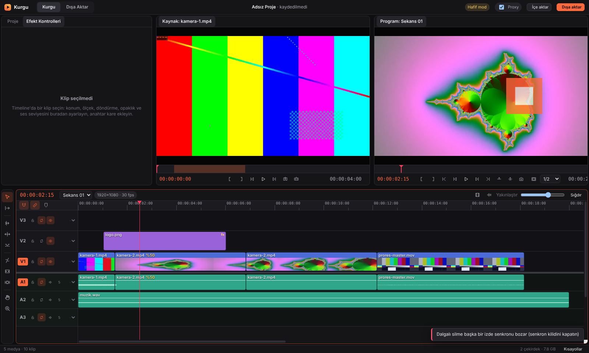

# BaseCut Pro

Ücretsiz, hafif, profesyonel masaüstü video kurgu programı — Windows ve macOS.
The Base Social tarafından geliştirilmektedir.



## Neden farklı

- **Çökmez:** Video çözme, render ve export ayrı bir süreçte çalışır. O süreç çökse bile editör açık kalır ve süreç kendini yeniden başlatır. Her düzenleme anında diske yazılır; elektrik gitse bile son düzenlemenize kadar geri dönersiniz.
- **Zayıf bilgisayarda akıcı:** Düşük donanım algılanınca hafif mod açılır, önizleme yarım çözünürlüğe geçer ve ağır dosyalar için arka planda proxy üretilir. Export her zaman orijinal dosyalardan, tam kalitede yapılır.
- **Profesyonel kurgu motoru:** Ekle/üzerine yaz, kaldır/ayıkla, jilet, ripple, rolling, slip, slide, hız esnetme, senkron kilidi, bağlı ses-görüntü, 3 ve 4 noktalı kurgu, ters oynatma, anahtar kareler. 39 otomatik test ve 400 rastgele düzenlemelik fuzz testi ile korunuyor.
- **Export öncesi kontrol:** Çevrimdışı medya, boşluklar, kare hızı uyuşmazlıkları ve en-boy oranı sorunları render başlamadan listelenir.
- **Tanıdık kısayollar:** J/K/L, I/O, `,` `.`, `;` `'`, Q/W, V A B N R C Y U H Z, Ctrl+K…

## Geliştirme

```bash
cd app
npm install
npm run dev          # geliştirme modunda çalıştır
npm test             # kurgu motoru + gerçek ffmpeg ile export testleri
npm run build        # derle
xvfb-run -a node tests/e2e.mjs <medya-klasörü> <çıktı-klasörü>   # uçtan uca test
```

Kurulum dosyaları GitHub Actions ile otomatik derlenir (`.github/workflows/build.yml`):
Windows (kurulum + taşınabilir), Mac Apple Silicon, Mac Intel. `v0.1.0` gibi bir etiket atıldığında GitHub Releases'a yüklenir.

## Proje yapısı

| klasör | ne var |
| --- | --- |
| `app/src/core` | Saf veri modeli, kurgu işlemleri, render grafiği (Electron'dan bağımsız, testli) |
| `app/src/main` | Masaüstü kabuğu, menüler, dosya işlemleri, otomatik kayıt, çökmeye karşı izole medya işçisi |
| `app/src/renderer` | Arayüz: proje paneli, monitörler, timeline, efekt kontrolleri, export |
| `replica/` | Ürün araştırması: özellik haritası (`features.csv`), kullanıcı yorumları analizi (`fixes.md`) |

## Lisans

BaseCut Pro özgür yazılımdır: **GNU Genel Kamu Lisansı sürüm 3 veya sonrası (GPL-3.0-or-later)** koşullarıyla dağıtılır; tam metin [LICENSE](LICENSE) dosyasındadır. Programı kullanabilir, inceleyebilir, değiştirebilir ve paylaşabilirsiniz. Değiştirilmiş sürümleri dağıtırsanız kaynak kodunu da aynı lisansla açmanız gerekir.

© 2026 The Base Social (Özgür Erdem Polat, Gamze Mete)

## Üçüncü taraf yazılımlar

Video işleme [FFmpeg](https://ffmpeg.org) ile yapılır. Programla birlikte gelen ffmpeg/ffprobe çalıştırılabilir dosyaları kendi lisanslarıyla (GPL/LGPL) dağıtılır; lisans metinleri kurulumda `resources/app.asar.unpacked/node_modules/ffmpeg-static/` altındadır ve kaynak kodu ffmpeg.org adresinden edinilebilir. Arayüz Electron ve React (MIT) üzerine kuruludur. Altyazı fontu Montserrat (SIL Open Font License), konuşma tanıma Whisper modelleri (MIT) ve transformers.js (Apache-2.0) ile yapılır.
